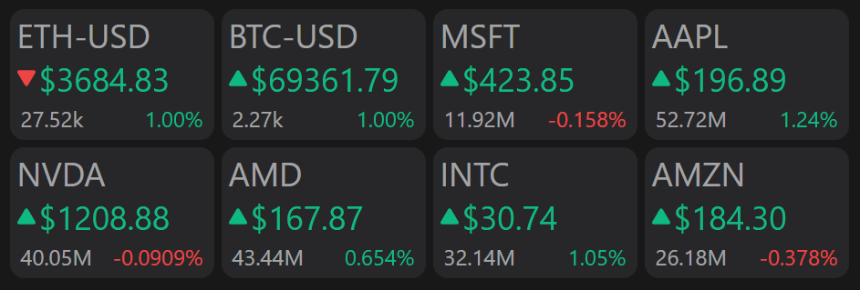

# Stock Tracker &middot; [](https://github.com/kajgm/stocktracker/blob/master/LICENSE) [](https://github.com/kajgm/stocktracker/actions/workflows/node.js.yml) 

A minimal full-stack tracker for Stocks and Cryptocurrencies. Intended for use on external Raspberry Pi based displays (3.5inch) or within a browser. Created to be deployed at scale.



## How it works

| Part | What it does |
|---|---|
| `server/` | Express + Socket.IO. Polls [Finnhub](https://finnhub.io/) for stock quotes and streams crypto prices from Coinbase's public WebSocket, then pushes updates to every connected display. |
| `client/` | Vue single-page app that renders the tickers. Connects to the server over Socket.IO. |
| MongoDB (optional) | Persists the ticker lists set through the API. Without it, the lists come from environment variables. |

Stocks are re-quoted every minute while the US market is open (09:30-16:00 New York time, daylight saving aware) and once at startup, so the last close shows outside market hours. Crypto updates stream continuously and are batched to at most two updates per second per ticker.

Built with [Node](https://nodejs.org/), [Vue](https://vuejs.org/), [Vite](https://vitejs.dev/), [Tailwind](https://tailwindcss.com/), [Express](https://expressjs.com/), [Socket.IO](https://socket.io/) and optionally [MongoDB](https://www.mongodb.com/).

## Prerequisites

- [Node](https://nodejs.org/en/download) 22 or later (CI and the `.nvmrc` use Node 26)
- For stock tickers: a free [Finnhub API key](https://finnhub.io/register). The free plan allows 60 calls per minute and covers US-listed stocks; other exchanges (e.g. TSX) need a paid plan. Crypto needs no key.

## Configuration

Copy `server/.env.template` to `server/.env` and fill it in.

| Variable | Default | Description |
|---|---|---|
| `FINNHUB_API_KEY` | (none) | Finnhub key. Without it, stock tickers stay on "Connecting...". |
| `STOCK_TICKERS` | (none) | Comma-separated US stock symbols, e.g. `AAPL,MSFT` |
| `CRYPTO_TICKERS` | (none) | Comma-separated Coinbase products, e.g. `BTC-USD,ETH-USD` |
| `STOCK_POLL_INTERVAL_MS` | `60000` | Stock refresh interval during market hours. Stretched automatically to stay under 60 calls/minute. |
| `MONGO_URI` | (none) | Persist ticker lists set through the API. Without it, lists set through the API last until restart. |
| `PORT` | `3000` | Server port |
| `CORS_ORIGINS` | `http://localhost:8080,http://localhost:5173` | Browser origins allowed to connect |

The client reads `VITE_SERVER_URL` (see `client/.env.template`, default `http://localhost:3000/`) at build time.

### Changing tickers at runtime

```sh
curl http://localhost:3000/api/tickers                                   # current lists
curl -X PUT http://localhost:3000/api/tickers \
  -H 'Content-Type: application/json' -d '{"stock": ["AAPL", "NVDA"]}'     # replace the stock list
curl -X PUT http://localhost:3000/api/tickers \
  -H 'Content-Type: application/json' -d '{"crypto": "BTC-USD,SOL-USD"}'   # replace the crypto list
curl -X DELETE http://localhost:3000/api/tickers                         # clear both
```

A list left out of a `PUT` is unchanged. Connected displays update immediately.

## Development

Install dependencies in both packages, then run the server and client in separate terminals:

```sh
cd server && npm install && npm run dev    # http://localhost:3000
cd client && npm install && npm run dev    # http://localhost:5173
```

| Task | Client (`client/`) | Server (`server/`) |
|---|---|---|
| Lint | `npm run lint` | |
| Type-check | `npm run typecheck` | `npm run typecheck` |
| Unit tests | `npm test` | `npm test` |
| Production build | `npm run build` | |

## Docker Deployment

To deploy with Docker, please follow these steps:

1. Install [Docker Engine](https://docs.docker.com/engine/install/)

   > Tip: Run `sudo usermod -aG docker <user>` to avoid prefixing the following commands with sudo

2. Create `server/.env` from `server/.env.template` (and `client/.env` from its template if the server is not on `http://localhost:3000/`)

3. Build the dockerfile within the `/client` directory

```sh
docker build -t kajgm/stocktracker-client .
```

4. Build the dockerfile within the `/server` directory

```sh
docker build -t kajgm/stocktracker-server .
```

5. Create a bridge network

```sh
docker network create -d bridge backend-net
```

6. Run the client, server, and database containers
   > Note: If running on a Raspberry Pi, you will need to download an alternative mongodb image. Please see steps under [Deployment on Raspberry Pi](#deployment-on-raspberry-pi)

```sh
docker run -d -p 8080:80 --name stocktracker-client --network backend-net --restart always kajgm/stocktracker-client
docker run -d -p 3000:3000 --name stocktracker-server --network backend-net --env-file=./.env --restart always kajgm/stocktracker-server
docker run -d --name mongodb-server --network backend-net -v stocktracker:/data/db --restart always mongo
```

## Deployment on Raspberry Pi

Ensure the Docker deployment steps from above are followed on the target Raspberry Pi

1. Mongodb currently does not support the ARM architecure used on Raspberry Pis. Please use the alternative image provided by themattman [mongodb-raspberrypi-docker](https://github.com/themattman/mongodb-raspberrypi-docker?tab=readme-ov-file#how-to-install)

2. If running these commands over ssh set the $DISPLAY environment variable

```sh
export DISPLAY=:0
```

3. Run chromium in fullscreen mode

```sh
chromium-browser --kiosk --app=http://localhost:8080/ --start-fullscreen --incognito
```

> Alternatively, you may need to append `nohup` and `&` to run the command in the background (if executing via ssh):

```sh
nohup chromium-browser --kiosk --app=http://localhost:8080/ --start-fullscreen --incognito &
```

As an alternative, a startup script has been provided in the root directory `./startup.sh`. Ensure that the script is executable before running or referencing in any automated startup routine.

```sh
chmod +x <username> ./startup.sh
```
